# European Aviation Network & Performance Intelligence

A Power BI dashboard on air passenger traffic, capacity and route networks in the four Nordic countries (Sweden, Norway, Denmark and Finland). It combines four public data sources (Eurostat, Avinor, Finavia and OurAirports) in one star-schema model with 79 DAX measures, six report pages and three report-page tooltips.

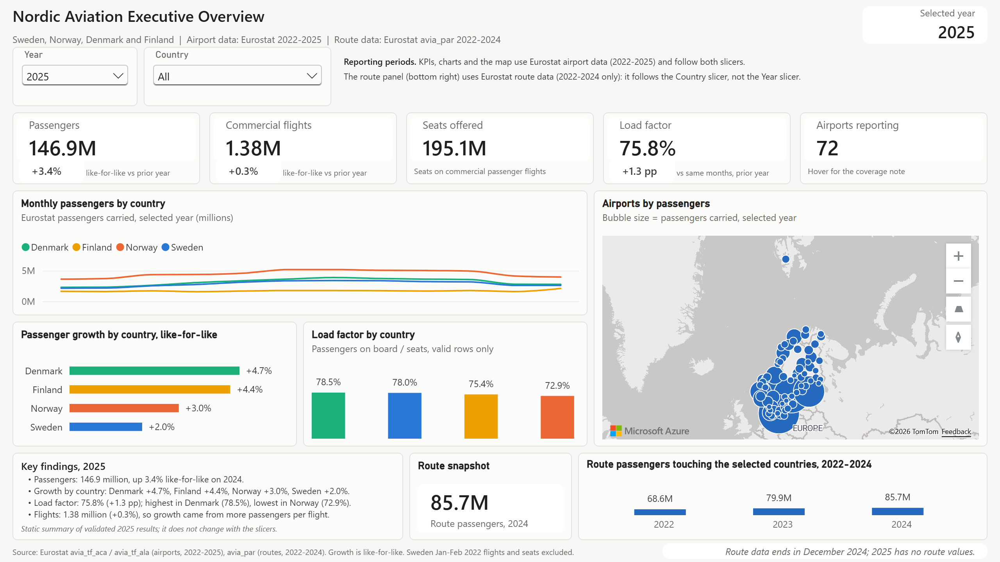

## Contents
- [Objectives](#objectives)
- [Key findings](#key-findings)
- [Dashboard pages](#dashboard-pages)
- [Data sources](#data-sources)
- [Methodology and data pipeline](#methodology-and-data-pipeline)
- [Data model](#data-model)
- [DAX measures](#dax-measures)
- [Data quality and validation](#data-quality-and-validation)
- [Technical skills and tools](#technical-skills-and-tools)
- [Repository structure](#repository-structure)
- [How to open and refresh the project](#how-to-open-and-refresh-the-project)
- [Add the Avinor and Finavia data](#add-the-avinor-and-finavia-data)
- [Limitations](#limitations)
- [Licence and attribution](#licence-and-attribution)

## Objectives
The dashboard answers five groups of business questions for the Nordic aviation market:

1. **Overall performance.** How many passengers did Nordic airports handle, how fast is traffic growing on a like-for-like basis, and is capacity used more efficiently (load factor)?
2. **Airports.** Which airports dominate the network, how does a single airport trend against last year, and how does it compare with its peers?
3. **Network and routes.** Which routes carry the most passengers, how is traffic split between domestic, Nordic cross-border and international routes, and how connected is each hub?
4. **Country deep dives.** What do the national operators' own statistics add for Norway (Avinor, 43 airports) and for Helsinki Airport (Finavia, 1998-2025)?
5. **Trust in the numbers.** How were four sources with different definitions combined, which gaps exist, and how well do the sources agree?

## Key findings
Figures are for 2025 unless stated otherwise; route figures are for 2024, the last year with Eurostat route data.

- **Traffic is still growing, mostly through more passengers per flight.** Nordic airports handled **146.9 million passengers**, **+3.4% like-for-like**, while commercial flights rose only **+0.3%** (1.38 million). The passenger load factor reached **75.8% (+1.3 percentage points)**.
- **Denmark grew fastest, Sweden slowest.** Like-for-like growth: Denmark +4.7%, Finland +4.4%, Norway +3.0%, Sweden +2.0%. Load factor is highest in Denmark (78.5%) and lowest in Norway (72.9%), which has many short regional routes.
- **Four hubs dominate.** Copenhagen (32.4 million passengers), Oslo-Gardermoen (27.0 million), Stockholm-Arlanda (24.3 million) and Helsinki (17.1 million).
- **The busiest routes link the Nordic capitals.** 85.7 million route passengers in 2024. Copenhagen-Oslo (1.36 million), Copenhagen-Stockholm (1.30 million) and Amsterdam-Copenhagen (1.16 million) lead. International routes outside the Nordics carry 83% of published route passengers (domestic traffic is understated because Norwegian domestic routes are confidential).
- **Panel effects matter.** Route growth in 2024 is +5.9% on a constant reporting panel, against +7.3% on reported totals, because some airports started reporting route data during the period.
- **Norway (Avinor).** 53.0 million terminal passengers (+3.4%); 43.0% of fixed-wing passengers are international and 16.9% are transfer passengers. Avinor and Eurostat agree within 0.3% in every year.
- **Helsinki has not fully recovered.** 16.98 million passengers in 2025 is 77.7% of the 2019 peak (21.9 million); the low was 5.1 million in 2020. The domestic share fell from 31.0% (1998) to 10.9% (2025), and the transfer share is 16.3% (peak 19.1% in 2019). Compound growth 1998-2025: +2.2% a year.

## Dashboard pages
The report has six pages (1280 x 720) and three hidden tooltip pages. Every page has a filter row, a KPI row, a main visual, supporting visuals and a footer that names the source and its main limitation.

### 1. Executive Overview
A one-screen answer to "How is Nordic aviation performing, and where is growth coming from?". KPIs with like-for-like comparisons, monthly passengers by country, growth and load factor by country, an airport bubble map (Azure Maps) with the airport tooltip, and a route snapshot. Slicers: year and country. (Screenshot at the top of this page.)

### 2. Airport Performance
Benchmarks one airport against its peers; also the drill-through target from the map. Monthly trend against the prior year, a month-by-year heatmap, share of Nordic passengers, top 10 departure destinations, flights and seats by month, and the share of airport traffic that the route data explains.

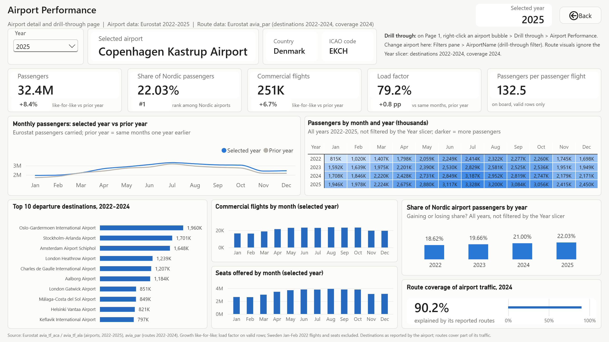

### 3. Network & Route Intelligence
The route network from Eurostat route data (2022-2024): top 10 two-way routes with the route tooltip, a destinations map, route volume against load factor, route scope mix, passengers by distance band and a connectivity table by origin airport. Norwegian domestic routes are confidential at Eurostat; they are counted and shown as blank, never as zero.

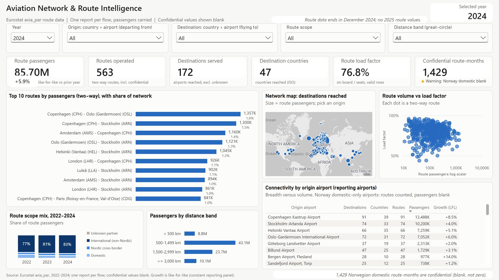

### 4. Norway Deep Dive (Avinor)
Avinor's own statistics for 43 Norwegian airports, including 17 small airports that Eurostat does not cover: domestic, international and offshore (helicopter) passengers, top airports by international passengers, Oslo transfer share, passengers against flight movements (indexed) and an Avinor-to-Eurostat data-trust table.

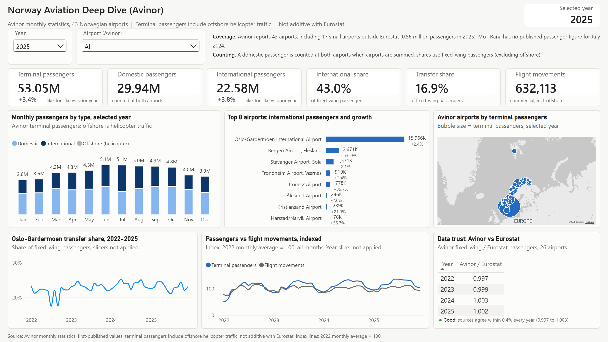

### 5. Helsinki Hub (Finavia)
Helsinki Airport from 1998 to 2025 using Finavia's annual statistics: long-term passengers, domestic against international traffic, transfer share, recovery against 2019, compound growth over any selected range, Finavia against Eurostat, and Eurostat monthly passengers and destinations.

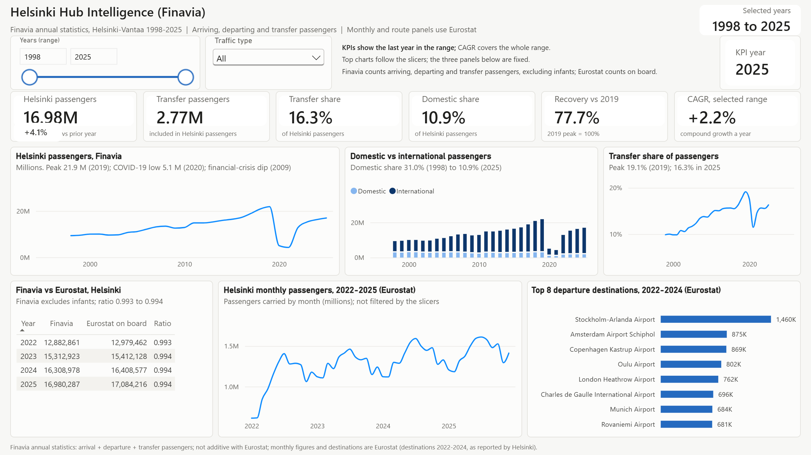

### 6. Data Quality & Methodology
How the four sources were combined and checked: data-quality KPI cards, a source coverage matrix (1998-2025), like-for-like against reported growth, data-trust ratios, the 16 quality rules built into the model and definitions of the passenger concepts.

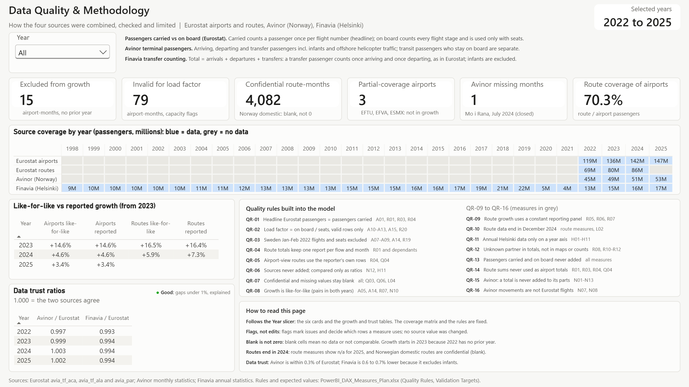

### Tooltip pages
Three report-page tooltips replace the default tooltips on the main visuals. They are hidden from page navigation.

| Tooltip | Shown on | Content |
|---|---|---|
| TT1 Airport | Page 1 airport map | Airport, country, ICAO code, passengers, like-for-like growth, load factor, Nordic rank, monthly sparkline |
| TT2 Route | Page 3 top 10 routes | Route, scope, distance, passengers, growth, load factor, confidential months, monthly line (gaps, not zeros) |
| TT3 Growth coverage | Growth figures on Pages 1 and 2 | Like-for-like against reported growth, airport-months excluded and the coverage note |

<p>
  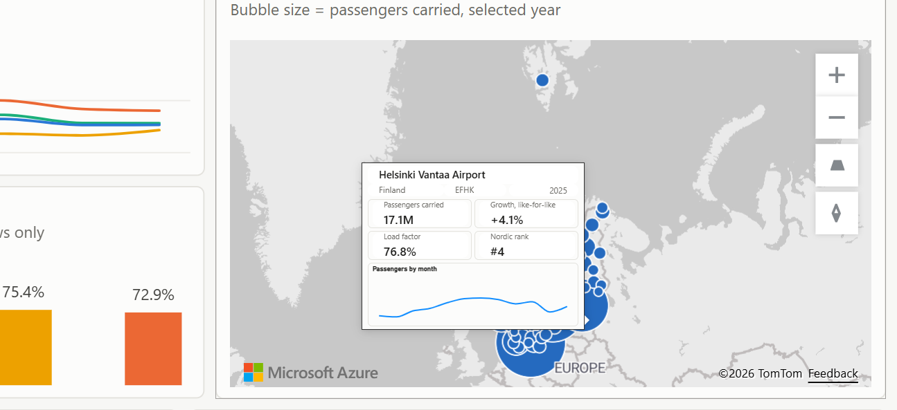
  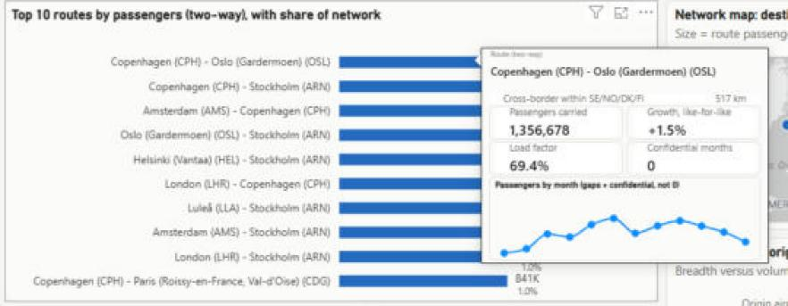
  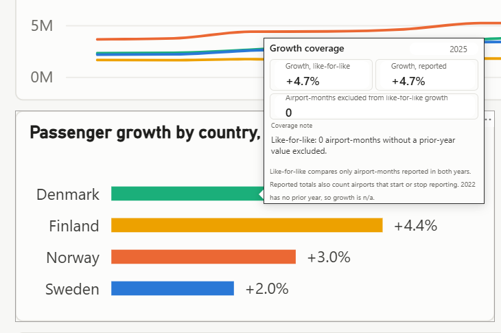
</p>

## Data sources
| Source | Datasets | Coverage | Used for | In this repository |
|---|---|---|---|---|
| [Eurostat](https://ec.europa.eu/eurostat) | `avia_tf_aca` (traffic by airport and aircraft model), `avia_tf_ala` (by airline licence), `avia_par_dk`, `avia_par_fi`, `avia_par_no`, `avia_par_se` (routes) | 76 airports, 2022-01 to 2025-12; routes 2022-01 to 2024-12 | Passengers, flights, seats, load factor, routes | Yes, processed CSV files (CC BY 4.0) |
| [OurAirports](https://ourairports.com/data/) | `airports.csv`, `countries.csv` | Airport names, codes and coordinates | Airport dimension and maps | Yes, in the airport dimension (public domain) |
| [Avinor](https://om.avinor.no/om-oss/trafikkstatistikk/) | Monthly traffic statistics (Excel), 48 monthly workbooks | 43 Norwegian airports, 2022-2025 | Norway deep dive (Page 4) | **No**, download from Avinor ([steps](#add-the-avinor-and-finavia-data)) |
| [Finavia](https://www.finavia.fi/en/about-finavia/about-air-traffic/traffic-statistics) | Helsinki Airport passengers 1998-2025 (Excel) | Helsinki Airport, annual | Helsinki page (Page 5) | **No**, download from Finavia ([steps](#add-the-avinor-and-finavia-data)) |

Data were downloaded on 2026-09-27 (one Avinor workbook on 2026-10-09). The Avinor and Finavia tables are not included because permission to redistribute them has not been confirmed; the repository holds header-only placeholders and two scripts that rebuild the tables from the publishers' own files. Licences, attribution and the changes made to the data are listed in [DATA_SOURCES.md](DATA_SOURCES.md).

## Methodology and data pipeline
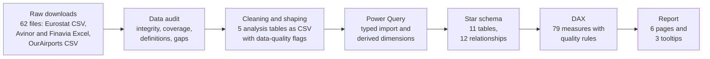

1. **Audit.** All 62 raw files were checked against the download manifest (row counts, duplicate keys, coverage, definitions). The audit set the scope: Eurostat airport data as the backbone; Avinor and Finavia only on their own pages; no airline-level or punctuality analysis because the sources do not support it.
2. **Cleaning and shaping.** Five analysis tables were produced as CSV files: airport-month, route-month, Avinor airport-month, Helsinki year and the airport dimension. Aggregate rows were removed, measures pivoted, codes standardised and every known issue marked with a `DQ_` flag instead of being edited. No value was estimated or filled in, and confidential values stay empty. The three Eurostat and OurAirports tables are in [`data/processed`](data/processed); the Avinor and Finavia tables are rebuilt with the scripts in [`scripts`](scripts), which reproduce the original tables exactly.
3. **Power Query.** The model imports the five CSV files with explicit data types. The date, year, route and role-playing airport dimensions are built in Power Query from these tables.
4. **Model and measures.** Star schema with single-direction relationships, a dedicated measure table and data-quality rules enforced inside the measures (for example, load factor only on rows where seats and passengers share a basis).

## Data model
Four fact tables at different grains are kept separate (no fact-to-fact relationships) and share conformed dimensions.

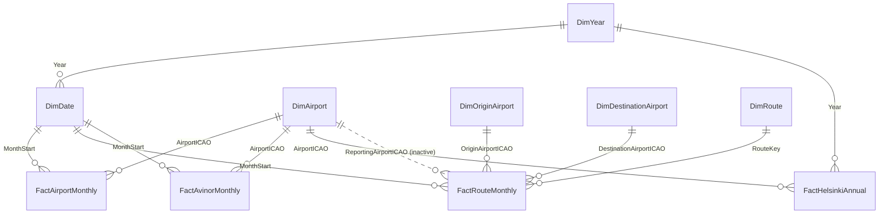

| Table | Type | Grain | Rows |
|---|---|---|---|
| FactAirportMonthly | Fact (Eurostat) | Airport x month | 3,496 |
| FactRouteMonthly | Fact (Eurostat) | Reporting airport x partner airport x direction x month | 42,001 |
| FactAvinorMonthly | Fact (Avinor) | Airport x month | 2,064 (built locally from Avinor's files) |
| FactHelsinkiAnnual | Fact (Finavia) | Year x traffic type | 56 (built locally from Finavia's file) |
| DimAirport | Dimension (OurAirports) | Airport | 215 |
| DimOriginAirport, DimDestinationAirport | Role-playing dimensions | Airport | 185 each |
| DimRoute | Dimension | Two-way route | 645 |
| DimDate | Date dimension | Day (2022-2025) | 1,461 |
| DimYear | Year dimension | Year (1998-2025) | 28 |
| _Measures | Measure table | | 79 measures |

All 12 relationships are one-to-many and single-direction; one (airport to route reporting airport) is inactive and used only through `USERELATIONSHIP`. More detail: [docs/DATA_MODEL.md](docs/DATA_MODEL.md).


## DAX measures
79 measures in six display folders:

| Folder | Measures | Examples |
|---|---|---|
| 01 Airport Performance | 19 | Total Passengers, Passenger Growth YoY % (like-for-like), Passenger Load Factor, Nordic Airport Passenger Rank |
| 02 Route Intelligence | 22 | Network Passengers, Route Passenger Growth YoY %, Routes Operated, Route Load Factor |
| 03 Norway (Avinor) | 16 | Avinor Terminal Passengers, Avinor International Share, Avinor vs Eurostat Ratio |
| 04 Helsinki (Finavia) | 11 | Finavia HEL Passengers, Finavia HEL CAGR (Selected Years), Finavia HEL Recovery vs 2019 |
| 05 Data Quality & Coverage | 7 | Airport-Months Excluded from Growth, Confidential Route-Months, Route Coverage of Airport Traffic |
| 06 Labels & Helpers | 4 | Selected Period Label, Growth Coverage Note |

Like-for-like growth compares only airport-months that have data in both years, so airports that start or stop reporting do not distort growth:

```dax
Total Passengers LFL =
SUMX (
    SUMMARIZE ( FactAirportMonthly, DimAirport[AirportICAO], DimDate[MonthStart] ),
    VAR Cur = [Total Passengers]
    VAR Prev = [Total Passengers PY]
    RETURN IF ( NOT ISBLANK ( Cur ) && NOT ISBLANK ( Prev ), Cur )
)

Passenger Growth YoY % =
DIVIDE ( [Total Passengers LFL] - [Total Passengers PY LFL], [Total Passengers PY LFL] )
```

Every measure with its description and DAX: [docs/DAX_MEASURES.md](docs/DAX_MEASURES.md).

## Data quality and validation
Sixteen quality rules are built into the measures. Examples:

- Confidential and missing values stay blank, never zero (4,082 confidential Norwegian domestic route-months).
- Load factor uses passengers on board divided by seats, only on rows where both are valid (79 airport-months excluded).
- Sweden January-February 2022 flights and seats are excluded because they are under-reported in the source.
- Sources are never added together; Avinor and Finavia are compared with Eurostat only as ratios (0.997 to 1.003 and 0.993 to 0.994).
- Growth is like-for-like; route growth uses a constant reporting panel.

Every KPI and visual was checked against DAX queries on the loaded model and against the expected values from the audit (for example 2025 passengers 146.9 million, like-for-like growth +3.4%, 2024 route passengers 85.7 million). The final end-to-end test covered navigation, slicers, drill-through, tooltips and confidentiality handling. Details: [docs/QA_AND_VALIDATION.md](docs/QA_AND_VALIDATION.md). The design-stage measure plan with the quality rules and validation targets is in [docs/PowerBI_DAX_Measures_Plan.xlsx](docs/PowerBI_DAX_Measures_Plan.xlsx) (it specifies 74 measures; five were added during the build, for 79 in total).

## Technical skills and tools
- **Power BI Desktop** with the Power BI Project format (**PBIP**): report in **PBIR** (one JSON file per page and visual) and semantic model in **TMDL**, so every change is readable in source control.
- **Power Query (M)** for typed imports and derived dimensions.
- **DAX** for time intelligence, like-for-like growth, ranks, ratios, coverage counts and dynamic labels.
- **Data modelling:** star schema, role-playing dimensions, inactive relationship with `USERELATIONSHIP`, measure table with display folders.
- **Report design:** consistent design system (fixed country colours, one blue ramp, status colours only for data quality), report-page tooltips, drill-through, synced slicers, Azure Maps.
- **Data preparation and checks:** scripted transformations (shell and JavaScript) with independent re-computation of every output table, dependency-free Node.js scripts that rebuild the Avinor and Finavia tables from the publishers' workbooks, and DAX validation queries against expected values.
- **Version control:** the whole report and model as plain-text files (PBIR JSON and TMDL) in Git.

## Repository structure
```
european-aviation-network-intelligence/
├── README.md
├── DATA_SOURCES.md                  Licences, attribution and changes to the source data
├── .gitignore
├── powerbi/
│   ├── European_Aviation_Intelligence.pbip
│   ├── European_Aviation_Intelligence.Report/         Report (PBIR): 9 pages and their visuals
│   └── European_Aviation_Intelligence.SemanticModel/  Model (TMDL): tables, relationships, 79 measures
├── data/
│   ├── README.md
│   ├── processed/                   CSV files the model loads (Eurostat and OurAirports data;
│   │                                header-only placeholders for Avinor and Finavia)
│   └── dictionaries/                Column definitions for each table (Excel)
├── scripts/                         Node.js scripts that build the Avinor and Finavia tables
└── docs/
    ├── DATA_MODEL.md
    ├── DAX_MEASURES.md
    ├── QA_AND_VALIDATION.md
    ├── PowerBI_DAX_Measures_Plan.xlsx   Design-stage measure plan, quality rules and validation targets
    └── images/                      Page, tooltip and model screenshots
```

## How to open and refresh the project
**Requirements:** Windows and a recent version of [Power BI Desktop](https://powerbi.microsoft.com/desktop/). The project uses the PBIP format with PBIR report files; if Power BI Desktop asks, turn on the Power BI Project (.pbip) and PBIR options under *File > Options and settings > Options > Preview features*.

1. **Get the files.** Clone the repository into a short folder path, for example `C:\Projects`:
   ```
   cd C:\Projects
   git clone https://github.com/ebuka26-cyber/european-aviation-network-intelligence.git
   ```
   Or download it with *Code > Download ZIP* and extract it there. Keep the path short: Windows limits file paths to 260 characters, the longest file in the project is 124 characters below the repository folder, and Power BI Desktop skips report files with longer paths (the pages then open empty).
2. **Open the project.** Open `powerbi\European_Aviation_Intelligence.pbip` in Power BI Desktop. The visuals are empty at first, because the data cache is not stored in the repository.
3. **Point the model to the data.** Select *Home > Transform data > Edit parameters* and set **DataFolder** to the full path of the `data\processed` folder, for example `C:\Projects\european-aviation-network-intelligence\data\processed`. The default value is that example path, so if you cloned the project there, you can skip this step.
4. **Refresh.** Select *Apply changes* (or *Home > Refresh*). The CSV files load in a few seconds. Pages 1, 2, 3 and 6 now work. The Norway (Avinor) and Helsinki (Finavia) pages stay empty until you add those two data sets (next section).
5. **Explore.** Start on *Executive Overview*. Hover over the map, the route chart and the growth figures for the tooltips; right-click an airport bubble and select *Drill through > Airport Performance* (in Power BI Desktop, Ctrl+click the *Back* button to return).

The maps use the Azure Maps visual. If they stay blank, check that Azure Maps is allowed in your Power BI Desktop options or by your organisation's Power BI settings.

To save your own copy in the classic single-file format, use *File > Save as* and choose `.pbix`.

## Add the Avinor and Finavia data
Pages 4 and 5 use statistics that Avinor and Finavia publish on their websites. Download them from the publishers and build the two tables locally:

1. **Install [Node.js](https://nodejs.org/)** version 18 or later. The scripts need no other packages.
2. **Download the Avinor workbooks.** On Avinor's traffic statistics page, [om.avinor.no/om-oss/trafikkstatistikk](https://om.avinor.no/om-oss/trafikkstatistikk/), download the monthly traffic figures ("Trafikktall", Excel) for every month from January 2022 to December 2025: 48 workbooks. Save them in one folder, for example `C:\Data\Avinor`. File names do not matter, because the script reads the month from the sheet names. Keep one workbook per month; if Avinor lists two versions of a month, keep one.
3. **Download the Finavia workbook.** On Finavia's [traffic statistics page](https://www.finavia.fi/en/about-finavia/about-air-traffic/traffic-statistics), under the long-term statistics, download [Helsinki Airport passengers 1998-2025](https://www.finavia.fi/sites/default/files/documents/Helsinki%20Airport%20passengers%201998-2025-fi-fi.xlsx) (Excel).
4. **Build the tables.** In a terminal opened in the repository folder, run:
   ```
   node scripts/prepare-avinor.js "C:\Data\Avinor"
   node scripts/prepare-finavia.js "C:\Data\Helsinki Airport passengers 1998-2025-fi-fi.xlsx"
   ```
   The scripts replace the placeholders `data/processed/FactAvinorMonthly.csv` (2,064 rows: 43 airports x 48 months) and `data/processed/FactHelsinkiAnnual.csv` (56 rows: 28 years x 2 traffic types). They stop with a message if a month is missing or duplicated, a workbook layout is unknown or a published total does not equal its parts.
5. **Refresh** in Power BI Desktop. Pages 4 and 5 now show the Avinor and Finavia figures.

The generated files are for your own use; do not commit them to a public repository. More detail: [scripts/README.md](scripts/README.md).

## Limitations
- Eurostat route data end in December 2024, so route visuals show no 2025 values.
- Norwegian domestic routes are confidential at Eurostat; they are counted but stay blank.
- The sources do not identify airlines and contain no delay or cancellation data, so the dashboard has no airline-level or punctuality analysis.
- Very small or closing airports can show extreme growth rates (for example, Thisted 2024 -100%, after it reported no passengers from March 2024). The values are correct; the growth tooltip shows the coverage behind them.
- Avinor, Finavia and Eurostat use different passenger definitions; they are shown on separate pages and compared only as ratios.
- The project must sit in a short folder path (see step 1 above); Power BI Desktop does not load report files whose full path is longer than 260 characters.
- The Avinor and Finavia data are not in the repository; Pages 4 and 5 need the publishers' files (see above). Avinor sometimes publishes a new version of a month's workbook (in October 2026 its page listed new files for June to December 2025), so a rebuild from today's files may differ slightly from the screenshots, which use the files downloaded on 2026-09-27.

## Licence and attribution
- **Included data:** Eurostat data, reused under [CC BY 4.0](https://creativecommons.org/licenses/by/4.0/) ("Source: Eurostat"), and OurAirports data, which is in the public domain.
- **Not included:** Avinor and Finavia data. The figures and screenshots on the Norway and Helsinki pages are based on their statistics ("Source: Avinor"; "Source: Finavia Corp.").
- Source data were filtered, reshaped and flagged. Eurostat, Avinor, Finavia and OurAirports are not responsible for these changes or for the analysis.

Full attribution and terms: [DATA_SOURCES.md](DATA_SOURCES.md).

Author: Ebuka God'sgift Ewuzie
